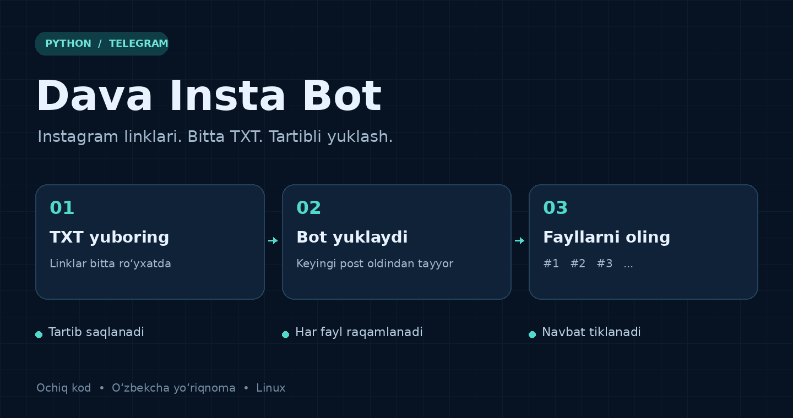
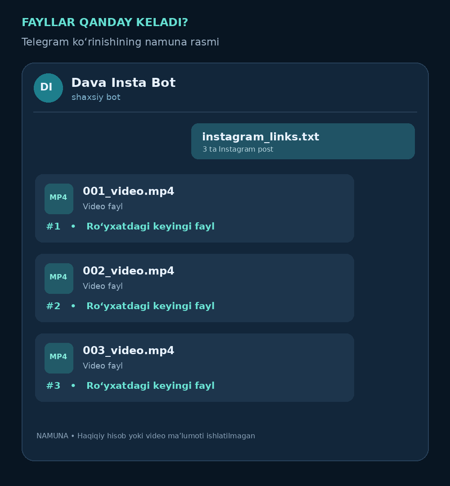

# Dava Insta Bot



## Tezkor yuklash va raqamlash

Har bir yuborilgan media fayl ro‘yxat ichida alohida `#1`, `#2`, `#3` tarzida raqamlanadi. Karuselning har bir fayli ham o‘z raqamiga ega. Fayl nomlari `001_…`, `002_…` ko‘rinishida boshlanadi. Raqamlar navbat bazasida saqlanadi; dastur qayta yoqilsa davom etadi. Yangi TXT ro‘yxat yoki `/retry` yangi ro‘yxat hisoblanadi va uning raqamlari 1 dan boshlanadi.

Telegramga bir post yuborilayotgan paytda keyingi post oldindan yuklanadi. Shu tariqa Instagramdan yuklash va Telegramga yuborish ustma-ust bajariladi, yetkazish tartibi esa saqlanadi. Har postdan keyingi 3 soniyalik sun’iy tanaffus olib tashlangan. Telegram yuborishlari orasidagi cheklov va RetryAfter kutishi saqlangan; haqiqiy tezlik internet, fayl hajmi va Instagram/Telegram javoblariga bog‘liq.

### Oldingi versiyani yangilash

Ishlayotgan botni `Ctrl+C` bilan to‘xtating. `Dava_Insta_Bot_Tezkor.zip` faylini Downloads papkasiga yuklab, terminalda bajaring:

```bash
python3 -m zipfile -e "$HOME/Downloads/Dava_Insta_Bot_Tezkor.zip" "$HOME"
cd "$HOME/Dava_Insta_Bot"
bash start.sh
```

Paket `data/` va `.venv/` papkalarini almashtirmaydi. Oldingi token, ulanish va navbat saqlanadi. Avval bot umuman o‘rnatilmagan bo‘lsa, `bash install.sh` ni bajaring.


Instagram postlari va Reels videolarini Telegram orqali navbat bilan yuklash uchun shaxsiy bot. Bitta link yoki linklar yozilgan TXT fayl yuboring — bot rasm va videolarni Telegramga asl fayl sifatida jo‘natadi.

## Imkoniyatlar

- Bir TXT faylda 1 000 tagacha post; linklar ketma-ket ishlanadi.
- Takrorlangan postlar bitta ro‘yxat doirasida olib tashlanadi.
- Karusel postlaridagi rasm va videolarni yuklash.
- SQLite’da saqlanadigan navbat va qayta ishga tushganda davom ettirish.
- `/status`, `/cancel` va `/retry` buyruqlari.
- Bir martalik ulash kodi orqali faqat egasiga ruxsat.
- Mahalliy Firefox’dagi Instagram sessiyasidan ixtiyoriy foydalanish.
- GNOME Clipboard History’dan Instagram linklarini TXT faylga chiqarish.

## Raqamlangan fayllar namunasi

Quyidagi rasm ishlash tartibini tushuntiruvchi namuna; haqiqiy Telegram skrinshoti emas.



## Talablar

Linux, Python 3.10 yoki yangiroq versiya, internet va BotFather orqali yaratilgan Telegram bot tokeni kerak. Yuklash boshlanishida kamida 1 GB bo‘sh disk bo‘lishi kerak.

## O‘rnatish

```bash
git clone https://github.com/Muqimovdavronbek/dava-insta-bot.git
cd dava-insta-bot
bash install.sh
```

Agar Python yoki venv o‘rnatilmagan bo‘lsa, Debian/Ubuntu/Kali’da:

```bash
sudo apt install python3 python3-venv
bash install.sh
```

1. Telegramda [@BotFather](https://t.me/BotFather) → `/newbot` orqali bot yarating.
2. Tokenni o‘rnatish vaqtida terminalga kiriting; u kiritilayotganda ekranda ko‘rinmaydi.
3. Firefox’da Instagramga kirilgan bo‘lsa, sessiyadan foydalanish savoliga `ha` yozishingiz mumkin.
4. Terminalda ko‘rsatilgan bot havolasini oching va `/start KOD` buyrug‘ini Telegramda o‘z botingizga yuboring.
5. Bitta post linkini yoki `instagram_links.txt` faylini botga yuboring.

Keyingi safar ishga tushirish:

```bash
bash start.sh
```

## Buyruqlar

| Buyruq | Vazifasi |
| --- | --- |
| `/start KOD` | Botni birinchi marta egasiga ulash |
| `/help` | Yordam |
| `/status` | Umumiy tarix va joriy navbat |
| `/cancel` | Joriy va kutilayotgan ishlarni to‘xtatish |
| `/retry` | Eng so‘nggi urinishi xato yoki qisman bo‘lgan postlarni qayta ishlash |

## Clipboard tarixidan linklar olish

```bash
python3 export_history.py
```

Natija `~/instagram_links.txt` fayliga yoziladi. Ushbu funksiya GNOME Clipboard History’ning `~/.cache/clipboard-history@alexsaveau.dev/database.log` manziliga mo‘ljallangan.

## Doimiy ishlash

GitHub kodni saqlaydi; repository’ga yuklashning o‘zi botni ishga tushirmaydi. Bot ishlayotgan kompyuter yoki server yoqilgan va internetga ulangan bo‘lishi kerak. Kompyuteringiz o‘chiq paytda ham foydalanish uchun uni doimiy serverga alohida joylashtiring.

## Limitlar

TXT fayl 1 MB dan kichik, har media fayli esa 49 MB gacha bo‘lishi kerak. Profil, kolleksiya va Stories linklari qabul qilinmaydi. Yopiq, o‘chirilgan yoki Instagram tomonidan cheklangan postlar yuklanmasligi mumkin. Qisman yuborilgan postni `/retry` qilish ayrim fayllarni qayta yuborishi mumkin.

Token, sessiya cookies’i va navbat bazasi ochiq repository’ga qo‘shilmaydi. Ular mahalliy `data/` papkasida qoladi; bu papka `.gitignore` orqali chiqarib tashlangan.

## Sinovlar

```bash
.venv/bin/python -m unittest discover -s tests -v
```

Sinovlar linklarni ajratish, navbat, restart, bekor qilish, kirish ruxsati, token saqlash va simulyatsiyalangan media yuborishni qamrab oladi. Haqiqiy Telegram/Instagram bilan jonli sinov uchun o‘zingizning bot tokeningiz va tegishli postlar kerak.

Batafsil yo‘riqnoma: [README_UZ.md](README_UZ.md).

## Texnologiyalar

Python · python-telegram-bot · gallery-dl · SQLite · asyncio


## Rasmlarni qayta yaratish

README rasmlari `docs/make_visuals.py` orqali chizilgan. Pillow o‘rnatilgan muhitda `python3 docs/make_visuals.py` buyrug‘i bilan qayta yaratiladi.
