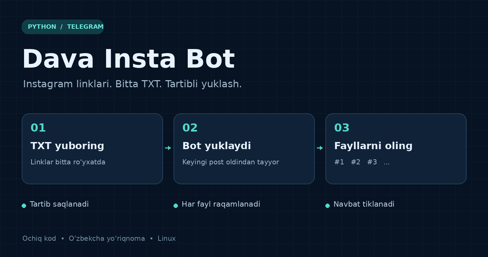
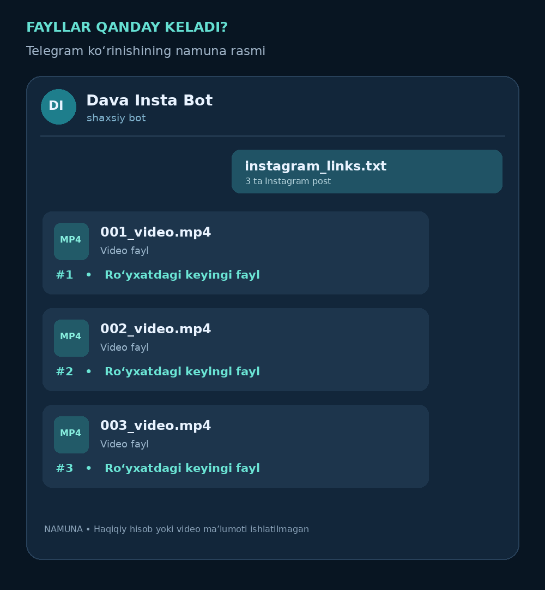

# Dava Insta Bot

**Queue Instagram posts and deliver their media to your personal Telegram bot.**



## Features

- A single post URL or a TXT batch of up to 1,000 posts.
- Carousel images and videos, delivered in order.
- Persistent SQLite queue with restart recovery.
- Per-file numbering, including individual carousel items.
- Owner pairing code and optional Firefox session reuse.
- Status, cancellation and retry commands.



The numbering image illustrates the workflow; it is not a Telegram screenshot.

## Quick start

Linux, Python 3.10+, internet access, a Telegram bot token and at least 1 GB free space are required.

```bash
git clone https://github.com/Muqimovdavronbek/dava-insta-bot.git
cd dava-insta-bot
bash install.sh
```

On Debian/Ubuntu/Kali, install `python3` and `python3-venv` if needed. Create a bot through BotFather, enter its token in the local installer and send the displayed `/start CODE` command to your bot.

Start subsequent sessions with `bash start.sh`.

## Usage

Send a post link, or a UTF-8 TXT file with one link per line. Each media file gets its own sequence number. The bot can download the next post while sending the current one, preserving delivery order.

| Command | Action |
| --- | --- |
| `/start CODE` | Pair the owner account |
| `/help` | Show help |
| `/status` | View history and queue status |
| `/cancel` | Cancel current and pending work |
| `/retry` | Retry the latest failed or partial posts |

## Limits and storage

TXT files must be under 1 MB; individual media files are limited to 49 MB. Profile, collection and Stories URLs are not supported. Private, deleted or restricted posts may fail. Retrying a partial post may resend some files.

Tokens, session cookies and queue data stay in the ignored local `data/` directory. GitHub stores the code; the bot runs only while its computer or server is online.

## Development

```bash
.venv/bin/python -m unittest discover -s tests -v
```

Tests cover parsing, queue persistence, access control and simulated media delivery. Real Telegram/Instagram operation needs your own configured bot.

Python · python-telegram-bot · gallery-dl · SQLite · asyncio.
